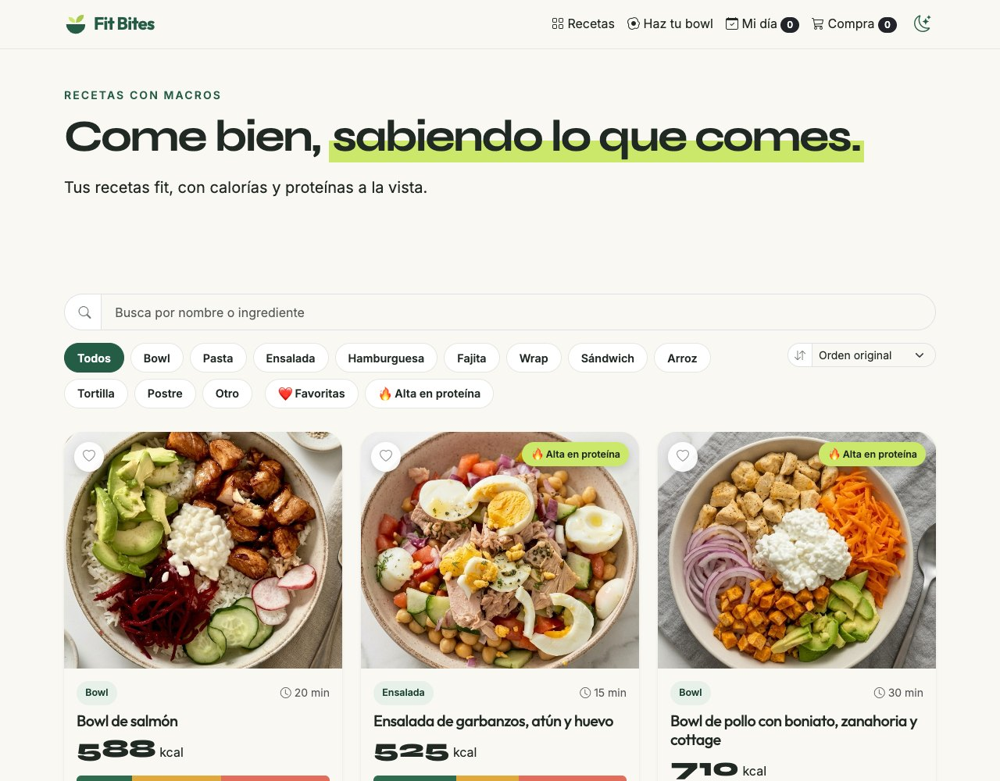
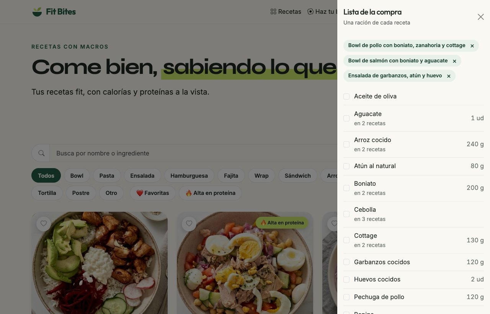
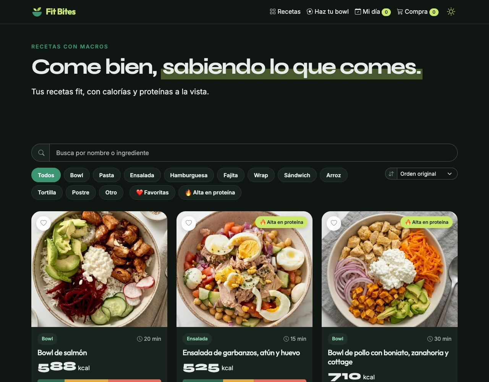
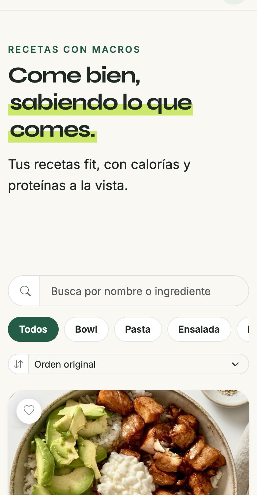
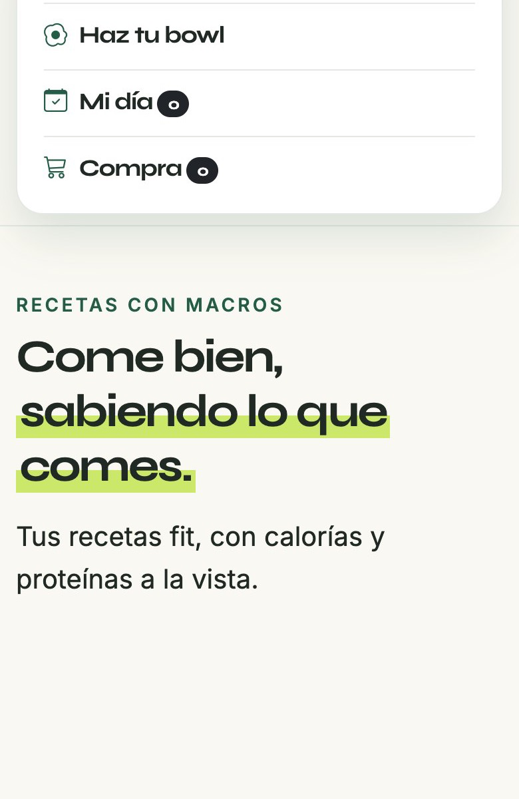

# 🥣 Fit Bites

**Tu diario de comidas: apunta lo que comes y se suma solo.**
Una web app para apuntar lo que comes por gramos, comida a comida, y ver al momento tus calorías, proteína, carbohidratos y grasas frente a tu objetivo. Con platos guardados, vista semanal con gráficos, recetas y cuentas para tenerlo todo en el móvil y en el ordenador.

👉 **[Ver la web en directo](https://taniadeazevedo.github.io/fit-bites/)** · se puede instalar en el móvil como una app.

> 📚 **Proyecto de aprendizaje.** Lo estoy construyendo para aprender desarrollo web (HTML, CSS, JavaScript y Bootstrap). Lo he ido haciendo paso a paso con ayuda de una IA, y el código está comentado línea a línea para poder leerlo y entenderlo.



## ✨ Qué hace

| | |
|---|---|
| 📝 **Diario por comidas** | Desayuno, comida, merienda y cena. Buscas un alimento (sin importar las tildes), pones los gramos y ves al momento cuánto suma; los gramos se pueden cambiar después. Barras de progreso frente a tu objetivo diario (editable). Puedes volver a días anteriores y apuntar lo que se te olvidó. |
| 🥑 **Tabla de alimentos** | Unos 60 alimentos con sus valores por 100 g **en crudo** (proteínas, lácteos, cereales, verduras, frutas, frutos secos…), cada uno con una ración típica. Puedes **crear los tuyos** copiando la etiqueta (las kcal se calculan solas). |
| 🔖 **Mis platos** | ¿Repites una comida? Guárdala como plato y añádela de un toque. |
| 🔐 **Cuentas** | Con Google o con email (Firebase). Tus datos se guardan en la nube y se sincronizan entre dispositivos. Sin cuenta, todo funciona igual y se guarda en el navegador. |
| 🍽️ **Recetas con macros** | Calorías, proteína, carbohidratos y grasas de cada receta, con una barra de reparto, foto, tipo de plato, tiempo e ingredientes. |
| ✏️ **CRUD completo** | Crear, editar y borrar recetas contra una API REST (`json-server`), con foto subida desde el formulario. |
| 🔎 **Filtros y orden** | Por tipo de plato, buscador (sin distinguir tildes) por nombre e ingredientes, 🔥 alta en proteína y ❤️ favoritas. Se puede ordenar por proteína, calorías, tiempo o nombre. |
| 📊 **Mi semana** | Resumen de lunes a domingo: media de kcal y proteína, días en los que llegaste a tu proteína y dos gráficos de barras (SVG hecho a mano) con la línea de tu objetivo. |
| ⚖️ **Raciones** | En el detalle de cada receta eliges las raciones (− 1½ +) y se recalculan las kcal, los macros y las cantidades de los ingredientes. Se apuntan en el diario por raciones. |
| 🛒 **Lista de la compra** | Marcas varias recetas y junta los ingredientes sumando las cantidades (`120 g + 100 g de salmón = 220 g`). Se pueden ir tachando y copiar. |
| 🌙 **Modo oscuro** | Recuerda tu elección o usa la del sistema. |
| 📱 **App instalable (PWA)** | Se puede añadir a la pantalla de inicio y abrir sin internet. |
| ♿ **Accesible** | Se puede usar solo con teclado (enlace «Saltar al contenido», contorno de foco visible), los botones dicen a qué receta afectan, los gráficos y las barras se describen para lectores de pantalla y los colores cumplen el contraste mínimo en los dos temas. |

<table>
  <tr>
    <td></td>
    <td></td>
  </tr>
  <tr>
    <td></td>
    <td align="center">
      
      
    </td>
  </tr>
</table>

## 🛠️ Tecnologías

- **HTML5** semántico y **CSS3** (variables, flexbox, grid, animaciones, tema oscuro, diseño responsive)
- **JavaScript** moderno, sin frameworks, dividido en **módulos** (`import` / `export`): `fetch` con `async/await`, `localStorage`, `IntersectionObserver`, canvas para reducir las fotos, gráficos en SVG, service worker
- **Bootstrap 5.3** y **Bootstrap Icons**
- **Firebase** (Authentication + Firestore) para las cuentas y guardar los datos en la nube
- **json-server** como API REST de pruebas
- **GitHub Pages** para publicarla
- Fuentes de Google Fonts: Syne, Outfit e Inter

## 🚀 Cómo ejecutarlo en local

1. Clona el repositorio y abre la carpeta en VS Code.
2. Abre `index.html` con la extensión **Live Server** (o con cualquier servidor estático).
3. Para poder **crear, editar y borrar** recetas, arranca la API en otra terminal:

   ```bash
   npx json-server json/recetas.json --port 3001
   ```

   Si no está encendida, la web funciona igualmente en **modo lectura**, que es lo que se ve en GitHub Pages (no hay servidor allí).
4. Para activar las **cuentas**, sigue [docs/firebase.md](docs/firebase.md) (unos 10 minutos). Mientras no lo hagas, todo se guarda en el navegador.

## 🗂️ Estructura

```
fit-bites/
├── index.html              # la página (con comentarios que explican cada parte)
├── css/estilos.css         # estilos: paleta, diario, tarjetas, tema oscuro...
├── js/                     # la lógica, en módulos y comentada línea a línea
│   ├── app.js              # punto de entrada: arranca cada parte
│   ├── config.js           # ajustes (comidas, categorías, objetivo por defecto...)
│   ├── almacen.js          # dónde se guardan tus datos (navegador + nube)
│   ├── nube.js             # Firebase: cuentas y sincronización
│   ├── cuenta.js           # la ventana de entrar / crear cuenta
│   ├── firebase-config.js  # la configuración de tu proyecto de Firebase
│   ├── dia.js              # el diario por comidas, la semana y los gráficos
│   ├── anadir.js           # la ventana para añadir alimentos, platos y recetas
│   ├── alimentos.js        # la tabla de alimentos y los que creas tú
│   ├── platos.js           # tus platos guardados
│   ├── recetas.js          # tarjetas de recetas, filtros, orden y favoritas
│   ├── detalle.js          # ventana de la receta con selector de raciones
│   ├── formulario.js       # crear y editar recetas (json-server)
│   ├── compra.js           # lista de la compra
│   ├── estado.js, utilidades.js, datos.js, fotos.js, interfaz.js   # herramientas compartidas
├── json/
│   ├── alimentos.json      # tabla de alimentos (por 100 g en crudo)
│   └── recetas.json        # las recetas (la "base de datos" de json-server)
├── imgs/recetas/           # fotos de las recetas
├── icons/ + manifest.webmanifest + sw.js   # app instalable (PWA)
└── docs/                   # capturas de este README y la guía de Firebase
```

## 🧠 Cómo está pensado

- **Mismo código en local y en la web publicada.** En local `app.js` habla con `json-server`; en GitHub Pages lee `json/recetas.json` como archivo y desactiva los botones de editar.
- **Lo personal pasa siempre por `almacen.js`**: tu diario (los últimos 120 días), objetivo, platos, alimentos propios, favoritas y lista de la compra. Se guarda siempre en el navegador (`localStorage`) y, si has entrado con tu cuenta, `nube.js` sube cada cambio a un documento tuyo en Firestore (`usuarios/{uid}`). Las reglas de seguridad solo dejan a cada persona leer y escribir el suyo.
- **El historial no cambia aunque cambie la tabla.** Cada alimento apuntado guarda una copia de sus valores, así corregir un dato o borrar un plato no reescribe los días pasados.
- **Módulos con un estado mínimo compartido.** Cada módulo guarda su propio estado y exporta solo lo que necesitan los demás; lo único compartido (las recetas cargadas) vive en `estado.js`. Como usan `<script type="module">`, hay que abrir la web con un servidor (Live Server), no con doble clic.
- **Fotos:** las que se suben desde el formulario se reducen en el navegador con un canvas antes de guardarlas; las de las recetas de ejemplo están en `imgs/recetas/`.
- **Offline:** el service worker guarda una copia al visitar la web. Usa la estrategia «primero la red»: si hay internet carga lo más nuevo, y si no, la copia guardada. Solo se registra en la web publicada, para no estorbar mientras se programa.

## 🎓 Lo que he ido aprendiendo

- Pedir y enviar datos con `fetch` y entender los métodos de una API REST (`GET`, `POST`, `PUT`, `DELETE`).
- Funciones asíncronas con `async/await` y manejo de errores con `try/catch`.
- Pintar la interfaz desde datos (plantillas de texto, `map`, `filter`, `reduce`, `sort`) y delegación de eventos.
- Guardar estado con `localStorage` y `JSON.parse` / `JSON.stringify`.
- Variables CSS, diseño responsive, animaciones y tema oscuro.
- Qué es un service worker y cómo funciona una PWA.
- Publicar con GitHub Pages y trabajar con Git.
- Dividir el código en módulos ES (`import` / `export`) y pensar qué estado comparte cada parte.
- Dibujar gráficos con SVG desde JavaScript y trabajar con fechas.
- Accesibilidad: foco con teclado, `aria-label`, `aria-pressed`, `aria-live` y contraste de color.
- Cuentas y base de datos en la nube con Firebase (Authentication y Firestore) y reglas de seguridad.

## 🔭 Próximos pasos

- [x] «Mi semana»: ver Mi día por días de la semana
- [x] Gráfico semanal de proteína y calorías
- [x] Escalar las raciones de cada receta
- [x] Diario por alimentos y comidas
- [x] Cuentas con Firebase
- [ ] Añadir los yogures y más alimentos
- [ ] «Copiar de ayer» en cada comida
- [ ] Más recetas

---

Valores nutricionales aproximados (tablas generales e introducidos por Tania y Cris). No sustituyen el consejo de un profesional.
